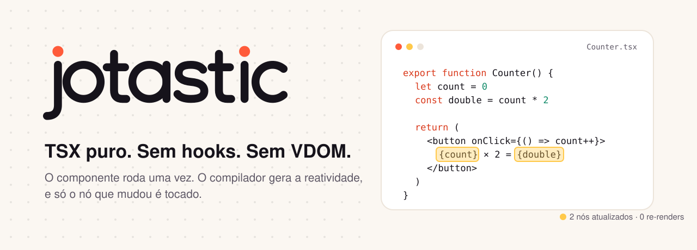
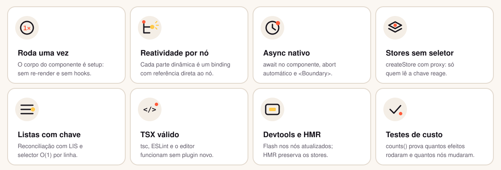
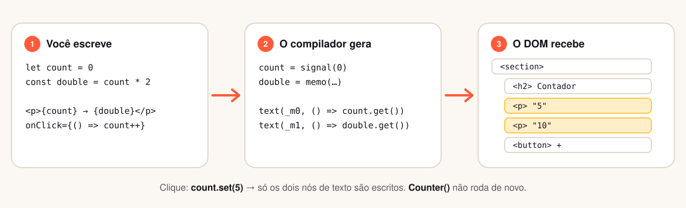
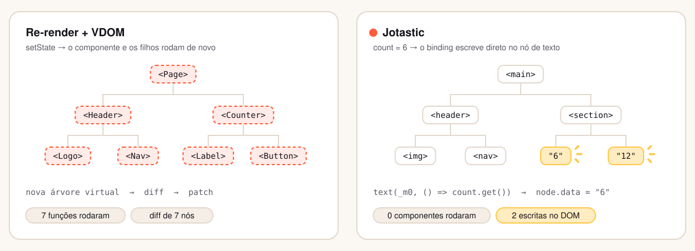
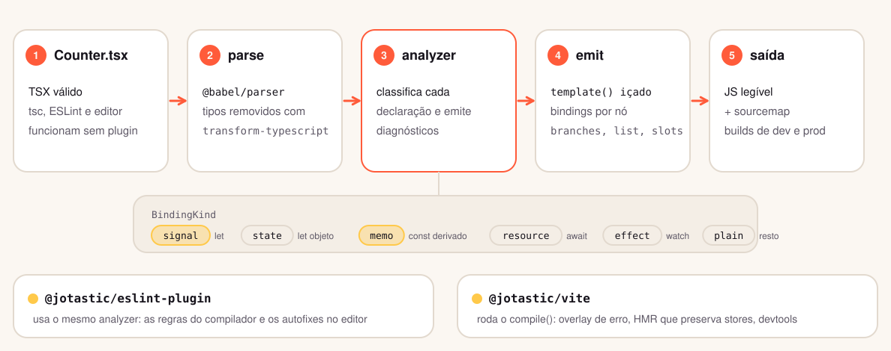
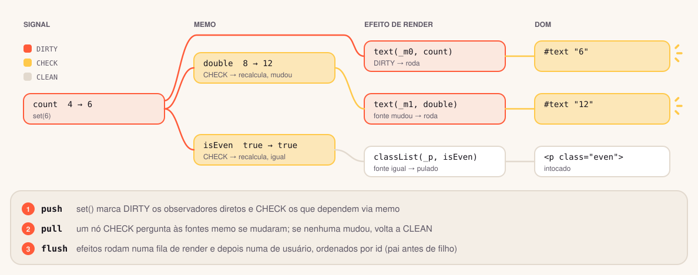
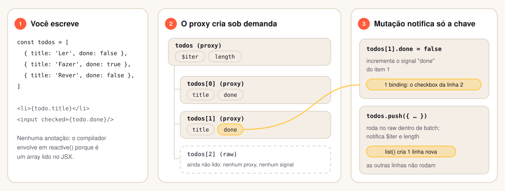
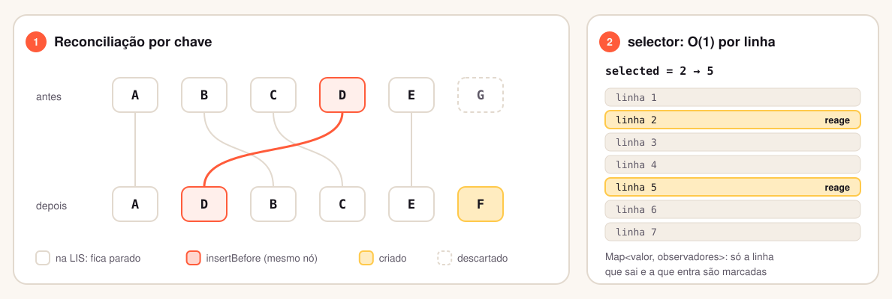
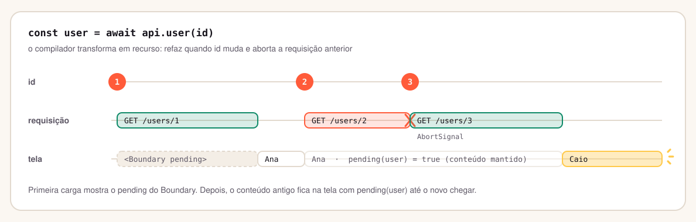
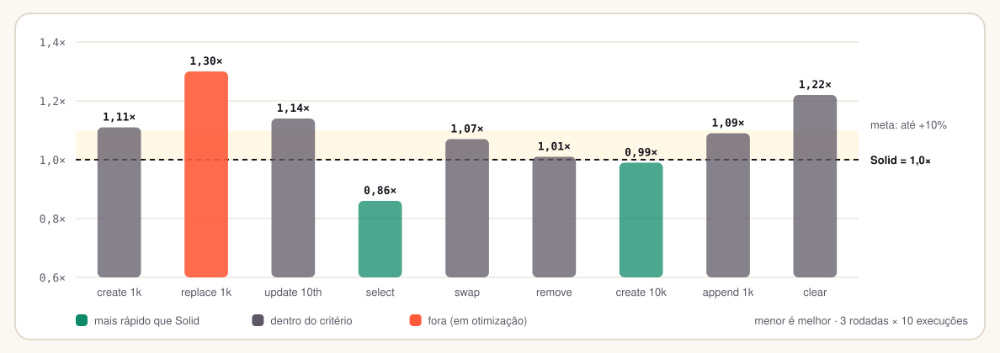

<div align="center">

<picture>
  <source media="(prefers-color-scheme: dark)" srcset="brand/banner-dark.svg">
  
</picture>

<p>
  <a href="https://github.com/JonathanSantos/jotastic-js/actions/workflows/ci.yml"></a>
  <a href="https://github.com/JonathanSantos/jotastic-js/actions/workflows/release.yml"></a>
  <a href="https://www.npmjs.com/package/jotastic"></a>
  <a href="https://www.npmjs.com/package/jotastic?activeTab=versions"></a>
  <br>
  
  
  
  
  
</p>

**Você escreve componentes como funções TypeScript comuns.<br>O compilador gera os signals, a memoização e as atualizações do DOM, nó por nó.**

[Começar](#-começar) · [Features](#-features) · [Como funciona](#-como-funciona) · [Técnicas](#-técnicas-aplicadas) · [Vindo do React](#-vindo-do-react) · [Pacotes](#-pacotes) · [Spec](docs/spec/README.md)

</div>

<br>

## ✦ A regra de ouro

> **1.** O corpo de um componente roda **uma vez**, de cima para baixo, como JS.<br>
> **2.** O que está no JSX, em `watch` ou num `const` que lê estado é **vivo**.<br>
> **3.** Reatribuir um `let` ou mutar um objeto é o que **dispara** a atualização.

Tudo na biblioteca deriva dessas três frases.

<br>

## ✦ Parece React. Não é React.

```tsx
import { mount } from 'jotastic'
import { cart } from './stores/cart'

export async function UserPage({ id }: { id: string }) {
  const user = await api.getUser(id)   // refaz quando `id` muda e cancela a anterior
  let editing = false                  // estado, sem useState
  const initials = user.name[0]        // derivado, sem useMemo

  return (
    <article>
      <span class="avatar">{initials}</span>
      <h1>{user.name}</h1>
      {editing && <EditForm user={user} />}
      <button onClick={() => (editing = !editing)}>Editar</button>
      <p>{cart.count} itens no carrinho</p>
    </article>
  )
}

mount(<UserPage id="42" />, '#app')
```

Sem `useState`, `useMemo`, `useCallback`, `useEffect`, array de dependências ou re-render. É **TSX válido**: `tsc`, ESLint e o seu editor funcionam sem plugin novo.

<br>

## ✦ Features

<picture>
  <source media="(prefers-color-scheme: dark)" srcset="brand/features-dark.svg">
  
</picture>

<br>

## ✦ Como funciona

<picture>
  <source media="(prefers-color-scheme: dark)" srcset="brand/how-it-works-dark.svg">
  
</picture>

O compilador lê o componente uma vez e classifica cada declaração:

| Você escreve | O compilador entende | Atualiza quando |
|:--|:--|:--|
| `let x = 0` | estado (`signal`) | você reatribui: `x = 1`, `x++` |
| `const list = []` | objeto reativo (proxy lazy) | você muta: `list.push(…)` |
| `const y = x * 2` | derivado (`memo`) | `x` muda **e** alguém lê `y` |
| `const user = await api.get(id)` | recurso (cancelável) | `id` muda |
| `watch(() => …)` | efeito com cleanup | algo que ele lê muda |
| `{a ? <X/> : <Y/>}` | branch | `a` muda de lado |
| `{items.map(i => <Row/>)}` | lista com chave | itens entram, saem ou se movem |
| `({ user })` nas props | leitura lazy | só o binding que lê `user` |

O template é **clonado** e cada parte dinâmica vira um binding com referência direta ao nó real. Atualizar é escrever no nó. Não existe árvore a comparar.

<picture>
  <source media="(prefers-color-scheme: dark)" srcset="brand/compare-dark.svg">
  
</picture>

<details>
<summary><b>Veja o que o compilador gera para o Counter</b></summary>

<br>

```js
import { template, signal, memo, insert, text, classList, bool, listen, component } from 'jotastic/runtime'
import { mount } from 'jotastic'

const _t0 = template('<section data-jo="Counter.tsx:14"><h2></h2><p><!> (dobro: <!>)</p>…</section>')

export function Counter(props) {
  const count = signal(0)
  const double = memo(() => count.get() * 2)
  const isEven = memo(() => count.get() % 2 === 0)

  const _el = _t0()
  // …nós resolvidos uma vez por firstChild/nextSibling…
  insert(_h2, () => props.label ?? 'Contador', null)
  classList(_p, () => ({ even: isEven.get(), odd: !isEven.get() }))
  text(_m0, () => count.get())
  text(_m1, () => double.get())
  listen(_b1, 'click', () => count.set(count.get() + (props.step ?? 1)))
  bool(_b3, 'disabled', () => count.get() === 0)
  return _el
}

mount(() => component(Counter, { step: 5 }), '#app')
```

Uma saída legível é requisito do projeto: nomes `_t0`, `_el`, `_m0`, imports nomeados e nenhuma IIFE. Clicar em **+5** executa **4 efeitos** e escreve **4 nós**. `Counter()` não roda de novo, e o teste de contrato garante isso.

</details>

<br>

## ✦ Técnicas aplicadas

### Compilador: o trabalho acontece no build

<picture>
  <source media="(prefers-color-scheme: dark)" srcset="brand/pipeline-dark.svg">
  
</picture>

- **Um analyzer, três consumidores.** A classificação (`signal`, `state`, `memo`, `resource`, `effect`, `plain`) é a mesma no compilador, no plugin ESLint e nos diagnósticos do Vite. O que o editor sublinha é exatamente o que o build faria.
- **Template içado.** O HTML estático vira um `template()` no topo do módulo e é clonado por instância. Os nós dinâmicos são resolvidos uma vez por `firstChild`/`nextSibling`, sem `querySelector`.
- **Saída legível.** Nomes `_t0`, `_el`, `_m0`, imports nomeados e nenhuma IIFE. Snapshots de referência em [`docs/spec/compiled`](docs/spec/compiled) garantem isso.

### Reatividade push-pull com coloração

<picture>
  <source media="(prefers-color-scheme: dark)" srcset="brand/reactive-dark.svg">
  
</picture>

- **Push** marca: `set()` pinta de `DIRTY` os observadores diretos e de `CHECK` os que dependem via `memo`.
- **Pull** confirma: um nó `CHECK` pergunta às fontes se mudaram de fato. Se nenhuma mudou, volta a `CLEAN` sem rodar. Um derivado que dá o mesmo resultado corta a propagação.
- **Flush ordenado**: efeitos de render antes dos de usuário, por id. Uma decisão (branch, lista) roda antes do conteúdo que ela renderiza, e bindings de um owner descartado são pulados.

### Objetos reativos: proxy profundo e lazy

<picture>
  <source media="(prefers-color-scheme: dark)" srcset="brand/proxy-dark.svg">
  
</picture>

- O alvo guarda sempre valores **raw**. O proxy de um filho só nasce quando ele é lido, e o signal de uma chave só nasce quando alguém observa.
- Métodos de iteração de array assinam um único signal estrutural (`$iter`), não um por índice. Mutadores rodam no raw dentro de `batch` e notificam só os índices afetados.
- O estado do proxy é o próprio handler: sem `WeakMap` extra por objeto nem consulta a cada leitura.

### Listas com chave e `selector`

<picture>
  <source media="(prefers-color-scheme: dark)" srcset="brand/lists-dark.svg">
  
</picture>

- Prefixo e sufixo comuns, `Map<chave, posição>` e **maior subsequência crescente (LIS)**: só as linhas fora dela são movidas, sempre o mesmo nó (`insertBefore`), nunca recriado.
- Chave igual com referência nova atualiza o signal da linha; nós e bindings são preservados.
- `selector` assina **por valor** (`Map<valor, observadores>`). Mudar a seleção numa lista de 10 mil linhas marca duas.

### Async como recurso

<picture>
  <source media="(prefers-color-scheme: dark)" srcset="brand/async-dark.svg">
  
</picture>

- `await` no corpo do componente vira um recurso: refaz quando o que ele lê muda e **aborta** a requisição anterior via `AbortSignal`.
- `<Boundary>` mostra `pending` só na primeira carga. Depois, o conteúdo antigo fica na tela, e `pending(user)` permite indicar o recarregamento sem piscar.
- Erros de setup, de handlers async e de recursos sobem até o `<Boundary error>` mais próximo, com `retry`.

<br>

## ✦ Começar

```bash
npm create jotastic@next meu-app
cd meu-app && npm install && npm run dev
```

O template vem com Vite, TypeScript strict, ESLint com as regras do compilador, um `Counter` e `@jotastic/test` configurado.

> [!NOTE]
> O Jotastic está em **pré-lançamento**: as versões saem na dist-tag `next` (`0.1.0-beta.1`). A API segue a [spec](docs/spec/README.md) e ainda pode mudar até a `0.1.0`.

<details>
<summary><b>Adicionar a um projeto Vite existente</b></summary>

<br>

```ts
// vite.config.ts
import jotastic from '@jotastic/vite'
export default { plugins: [jotastic()] }
```

```jsonc
// tsconfig.json
{ "compilerOptions": { "jsx": "preserve", "jsxImportSource": "jotastic", "strict": true } }
```

```js
// eslint.config.js
import jotastic from '@jotastic/eslint-plugin'
export default [jotastic.configs.recommended]
```

</details>

<br>

## ✦ Vindo do React

| Sai | Entra | Por quê |
|:--|:--|:--|
| `useState` | `let` | o compilador gera o signal |
| `useMemo`, `useCallback`, `memo` | `const`, função comum, nada | o componente roda uma vez |
| `useEffect` + deps | `watch`, `on`, `external` | as dependências vêm da leitura |
| `useRef` | `let el!: HTMLElement` + `ref={el}` | o compilador atribui o elemento |
| Regras dos hooks | nenhuma | funções `use*` são funções comuns |
| `value` + `onChange` a cada tecla | `value={x}` | o two-way é gerado |
| `<Suspense>` + ErrorBoundary | `await` + `<Boundary pending error>` | o compilador gera o recurso |
| `Children.map` + `child.type` | `<Slot name>` + `useSlots` | slots resolvidos em build |
| Zustand com seletores | `createStore` sem seletores | o proxy rastreia por propriedade |

Continuam iguais: JSX, componentes como funções, props, `children`, `key`, `ref`, `onClick`, fragmentos e composição.

<br>

## ✦ Uma API pequena

<table>
<tr>
<td valign="top" width="50%">

**Estado e efeitos**

```tsx
let query = ''
const results = items.filter(i => i.name.includes(query))

watch(() => {
  document.title = `${results.length} resultados`
})

on(window, 'resize', () => …)   // removido no unmount
const chart = external(
  () => new Chart(canvas, cfg),  // criado depois do DOM
  (c) => c.update(),             // quando o que lê muda
)
```

</td>
<td valign="top" width="50%">

**Async sem cerimônia**

```tsx
export async function UserCard({ id }) {
  const user = await api.user(id)   // aborta a anterior
  return <h2 class={{ dimmed: pending(user) }}>{user.name}</h2>
}

<Boundary
  pending={<Skeleton />}
  error={(e, retry) => <ErrorBox error={e} onRetry={retry} />}
>
  <UserCard id={id} />
</Boundary>
```

</td>
</tr>
<tr>
<td valign="top">

**Store global, sem seletor**

```ts
export const cart = createStore(
  { items: [] as CartItem[] },
  (set, get) => ({
    get count() { return get().items.length },
    add: (p: Product) => set(s => { s.items.push({ ...p, qty: 1 }) }),
  }),
)
// <p>{cart.count}</p> só reage a `count`
```

</td>
<td valign="top">

**Lógica reutilizável é só uma função**

```ts
import { fetch } from 'jotastic/fetch'

export function useFetch<T>(url: string) {
  let data: T | null = null
  let error: unknown = null
  watch(() => {
    fetch(url)                       // signal ambiente: abortado no cleanup
      .then(r => r.json()).then(d => (data = d), e => (error = e))
  })
  return { data, error }             // getters gerados
}
```

</td>
</tr>
</table>

O MVP tem **dezoito itens** de API e nenhuma sintaxe nova no JSX.

<br>

## ✦ Números

<table>
<tr>
<td align="center" width="25%"><h3>~3,4 KB</h3><sub>brotli, app Counter inteira em prod</sub></td>
<td align="center" width="25%"><h3>0</h3><sub>dependências no runtime</sub></td>
<td align="center" width="25%"><h3>1×</h3><sub>execuções do corpo de um componente</sub></td>
<td align="center" width="25%"><h3>700+</h3><sub>testes de contrato, snapshot e comportamento</sub></td>
</tr>
</table>

No **benchmark local** no formato do js-framework-benchmark, comparado com Solid no mesmo Chrome (3 rodadas × 10 execuções, critério: falha se passar de +10% **e** de +2 ms em 2 de 3 rodadas):

<picture>
  <source media="(prefers-color-scheme: dark)" srcset="brand/bench-dark.svg">
  
</picture>

<details>
<summary>Tabela</summary>

| create 1k | replace 1k | update 10th | select | swap | remove | create 10k | append 1k | clear |
|:-:|:-:|:-:|:-:|:-:|:-:|:-:|:-:|:-:|
| 1,11× | **1,30×** ✗ | 1,14× | **0,86×** | 1,07× | 1,01× | **0,99×** | 1,09× | 1,22× |

</details>

*Replace* ainda está em otimização (`npm run bench`). A meta registrada na spec é ficar dentro de Solid + 10%.

<br>

## ✦ Pacotes

| Pacote | O que é |
|:--|:--|
| [`jotastic`](packages/jotastic) | runtime e API pública, mais `jotastic/store` e `jotastic/fetch`, com builds separados de dev e prod |
| [`@jotastic/compiler`](packages/compiler) | plugin Babel que transforma TSX em template, signals e bindings |
| [`@jotastic/analyzer`](packages/analyzer) | análise pura (classificação e diagnósticos), compartilhada pelo compilador e pelo ESLint |
| [`@jotastic/vite`](packages/vite) | plugin Vite com overlay de erro, sourcemaps, HMR que preserva stores e devtools em dev |
| [`@jotastic/eslint-plugin`](packages/eslint-plugin) | as mesmas regras e autofixes do compilador, direto no editor |
| [`@jotastic/devtools`](packages/devtools) | overlay de flash nos nós atualizados e contadores por flush (`Alt+J`) |
| [`@jotastic/test`](packages/test) | `render`, `tick` e `counts()`: o teste que prova que só o necessário rodou |
| [`create-jotastic`](packages/create-jotastic) | `npm create jotastic` |

```bash
npm i jotastic@next
npm i -D @jotastic/vite@next @jotastic/eslint-plugin@next @jotastic/test@next
```

O runtime também sai no jsDelivr e no unpkg, para código **já compilado** (o TSX passa pelo compilador):

```html
<script type="module">
  import { mount } from 'https://cdn.jsdelivr.net/npm/jotastic@next/+esm'
</script>
```

```ts
import { render, tick, counts } from '@jotastic/test'

const { container } = render(<Counter step={5} />)
container.querySelector('button')!.click()
await tick()
expect(counts()).toEqual({ effects: 4, memos: 2, writes: 4 })   // e nada mais
```

<br>

## ✦ Exemplos

Todos rodam com `npm run dev -w examples/<nome>`:

| | Exemplo | Mostra |
|:-:|:--|:--|
| 🔢 | [`counter`](examples/counter) | `let`, `const` derivado, eventos |
| ✅ | [`todomvc`](examples/todomvc) | listas com chave, mutação profunda, two-way, filtros |
| 🛒 | [`cart`](examples/cart) | `createStore`, getters, ação async |
| 🪟 | [`modal`](examples/modal) | `<Portal>`, `<Boundary>` capturando handler async, `ref`, `tick` |
| ⏳ | [`async`](examples/async) | `await` no componente, `pending`, `refresh`, optimistic update |
| 🎨 | [`styling`](examples/styling) | `class` em objeto e array, `style` em objeto, variáveis CSS |
| 🧩 | [`slots`](examples/slots) | `<Slot name>`, slots com parâmetro e slots condicionais |

<br>

## ✦ Desenvolvimento

```bash
npm install
npm test          # todos os pacotes e exemplos
npm run build
npm run dev       # examples/counter
npm run size      # tamanho brotli por cenário
npm run bench     # Jotastic vs Solid (Chrome do sistema)
```

**Release:** uma tag `v*` dispara o workflow [`release.yml`](.github/workflows/release.yml), que roda build, testes e size, aplica a versão da tag aos 8 pacotes ([`scripts/set-version.mjs`](scripts/set-version.mjs)), publica no npm com provenance (tags com `-beta`/`-rc` vão para `next`) e cria a GitHub Release.

```bash
git tag v0.1.0 && git push origin v0.1.0
```

Monorepo com npm workspaces, TypeScript strict em ESM, tsup, Vitest e happy-dom, e Babel no compilador. A **spec normativa** fica em [`docs/spec`](docs/spec/README.md): os contratos `.d.ts` são a fonte da verdade, e há saídas compiladas de referência e o plano de testes por ID (R, P, D, F, E, S e A).

<br>

<div align="center">

<picture>
  <source media="(prefers-color-scheme: dark)" srcset="brand/logo-dark.svg">
  
</picture>

<sub>Feito com poucos nós. MIT.</sub>

</div>
