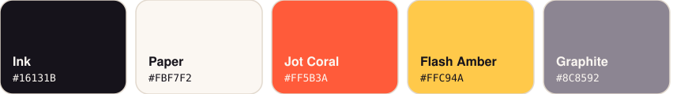

# Marca Jotastic

 

**Ideia:** *jot* é uma anotação mínima, um pingo. O Jotastic muda só o pingo: o nó que mudou, nunca a árvore. Os pingos coral do **j** e do **i** são os signals; os três riscos âmbar no símbolo são o *flash* de uma atualização granular, a mesma cor do overlay do `@jotastic/devtools`.

## Arquivos

| Arquivo | Uso |
|---|---|
| `mark.svg` / `mark-light.svg` | símbolo (avatar, favicon, ícone de app) em fundo escuro / claro |
| `logo-light.svg` / `logo-dark.svg` | símbolo + wordmark, para fundo claro / escuro |
| `banner-light.svg` / `banner-dark.svg` | topo do README e redes sociais (1280×460) |
| `how-it-works-*.svg` | diagrama "você escreve → compilador → DOM" |
| `features-*.svg` | grade de features do README |
| `compare-*.svg` | re-render com VDOM × escrita direta por nó |
| `pipeline-*.svg` | pipeline do compilador (parse → analyzer → emit → saída; ESLint e Vite) |
| `reactive-*.svg` | núcleo push-pull (DIRTY / CHECK / CLEAN) |
| `proxy-*.svg` | proxy profundo e lazy, signals por chave |
| `lists-*.svg` | reconciliação por chave com LIS e `selector` |
| `async-*.svg` | linha do tempo de `await`, abort e `<Boundary>` |
| `bench-*.svg` | benchmark relativo ao Solid (dados em `BENCH`, no `build.py`) |
| `palette.svg` | paleta |
| `build.py` | gera todos os SVGs (`python3 brand/build.py`) |
| `index.html` | prévia de tudo (`python3 -m http.server -d brand`) |

## Paleta

| Nome | Hex | Papel |
|---|---|---|
| Ink | `#16131B` | texto, fundo escuro |
| Paper | `#FBF7F2` | fundo claro |
| Jot Coral | `#FF5B3A` | o pingo: acento principal, links, destaques |
| Flash Amber | `#FFC94A` | atualizações, "o que mudou" (devtools) |
| Graphite | `#8C8592` | texto secundário |

## Wordmark

Desenhado à mão como traço monolinha (13 px, pontas arredondadas, altura-x 56), sem fonte: renderiza igual em qualquer lugar e sem licença de tipografia. Sempre em minúsculas: **jotastic**. Os pingos do `j` e do `i` são sempre coral.

## Tipografia de apoio

Sistema (`ui-sans-serif`, `-apple-system`, `Segoe UI`) para texto e `ui-monospace` para código: nada a carregar.

## Não faça

- Não troque o coral dos pingos por outra cor nem os remova.
- Não use o âmbar como cor de texto sobre Paper (contraste baixo); ele é cor de destaque/fundo.
- Não distorça nem contorne o wordmark; para tamanhos < 24 px use só o símbolo.
